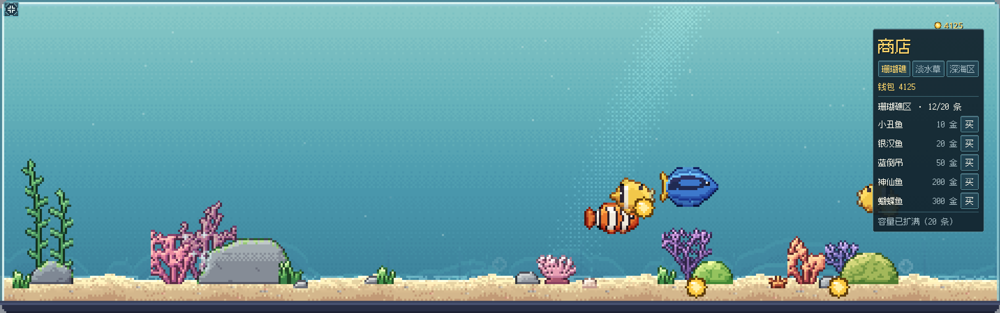

# 摸鱼水族馆

挂在电脑桌面底边的像素水族馆。Godot 4.7 + GDScript，像素素材由 `tools/` 下的 Python 脚本生成。



## 运行

需要 [Godot 4.7](https://godotengine.org/)，并且 `godot` 命令在 PATH 里。目前只在 macOS 上调过。

```bash
./run.sh
```

`site/` 是介绍页和幻灯片，纯静态文件，直接起个静态服务器就能看。

## 三座馆

横向一条长缸，切成三段，每段正好一屏宽，风格各自独立。

| 展区 | 水色 | 布景 | 鱼 |
|---|---|---|---|
| 珊瑚礁区 | 亮蓝绿，有阳光光柱 | 鹿角珊瑚、脑珊瑚、扇珊瑚、海葵 | 开局自带 8 条 |
| 淡水草缸区 | 暖绿，光柱很淡 | 水草丛生、石头顶长草，没有珊瑚 | 开局空着，商店里买 |
| 深海区 | 近黑，光柱和焦散全关 | 礁石压成冷青，摆得疏 | 开局空着，商店里买 |

淡水区和深海区的鱼**暂时是珊瑚礁那几张图改了色**（孔雀鱼=银汉鱼染绿、七彩神仙=蝴蝶鱼染暖、
灯笼鱼=银汉鱼染蓝……），品种表在 `catalog.gd`。M3 补真图之前，玩法先能跑通。

## 操作

| 操作 | 作用 |
|---|---|
| 左上角那个突出的圆角小挂耳 / 空格 | 展开 / 收起 |
| Esc | 收起 |
| 展开形态左右拖 / 触控板横滑 / 滚轮 | 浏览整条缸，三区开局全开，滑过去就到。商店页签跟着镜头换区；点页签镜头也会推过去。20 秒没人碰才按馆巡游 |
| 展开形态点水里 | 在这一竖线的水面撒一粒饵料：先浮一下，再加速沉到终端速度，边沉边晃，落底停在沙上。最近的鱼加速游过去吃掉，接下来两分钟产币翻倍 |
| 展开形态点金币 | 收进钱包。不点也行：两种形态金币落到沙上 2.5 秒都会自己进钱包 |
| 展开形态右侧商店 | 买鱼、扩建容量。买的鱼从水面「扑通」跳进来（有音效），落在看得见的那截水中间 |
| P | 截图到 `godot/shots/manual.png` |

挂件形态除了挂耳全部点击穿透，鼠标移上来会变淡，不挡后面的窗口。
挂件形态的镜头每 20 秒自动推到下一座馆，右上角一直显示钱包。
没有昼夜：水色全天一样，不跟着钟点变暗。

## 外壳：留白、圆角、挂耳

整个窗口是透明的，缸画在一块圆角矩形里（`shaders/round.gdshader`，按 SDF 裁），
所以四角外是透的，能看见桌面。圆角是把玻璃框、水、鱼一起裁的——
只让边框圆、四角里的水还是方的，那就假了。

留白按 `main.gd` 顶上的几个常量算，都在 `usable rect` 里算，避开 Dock 和菜单栏：

| 常量 | 值 | 作用 |
|---|---|---|
| `MARGIN_X` | 30 | 左右各留一截，缸不贴屏幕边，也不压在 Dock 底下 |
| `MARGIN_BOTTOM` | 16 | 离屏幕底边 |
| `TAB_H` | 46 | 顶部一条，挂耳坐在这里，**浮在缸外面**，不挤在缸里面 |
| `EXPAND_MARGIN` | 30 | 展开形态四周留白 |
| `RADIUS_STRIP` / `RADIUS_EXPAND` | 18 / 22 | 圆角半径（物理像素） |

挂件形态的窗口比缸宽 `2 * MARGIN_X`，右半截是透明的，正好当右边距；
左边那截靠把窗口摆在 `usable.position.x + MARGIN_X` 来让。挂耳是 `Button` 而不是
`TextureButton`，用圆角 StyleBox 画底、`expand_icon` 撑满，鼠标移上去会发亮——
原来那个 13×13 的小方块贴在底边上，基本注意不到。

## 数值

数值抄自 PRD 的「起步数值」，集中在 `godot/catalog.gd` 一个文件里，调价只动它。

- 珊瑚礁区开局自带 8 条鱼。三区都开着，每区容量 8。
- 容量 8 → 12（300 × 展区序号）→ 20（1500 × 展区序号）。
- 钱存在 `user://aquarium.json`：钱包、每区的容量、每条鱼的品种 / 展区 / 位置。
  改动时、每 15 秒、退出时各存一次。
- 离线最多按 8 小时结算，开的时候在底部给一行提示（M4 换成完整的结算框）。

## 改美术

```bash
python3 tools/make_art.py --preview     # 出图到 godot/art/，验收图到 godot/shots/
cd godot && godot --headless --import   # 让 Godot 重新导入
```

- `tools/px_core.py`：统一管线。色带（暗部偏冷、亮部偏暖）、距离场光照（左上来光）、选择性描边
- `tools/fish.py`：鱼的轮廓和花纹，摆尾 4 帧自动生成
- `tools/decor.py`：珊瑚、礁石、水草、沙、远景、玻璃框、按钮

## 自检截图

```bash
cd godot
godot --path . -- --shot=res://shots/out.png --wait=4                  # 挂件
godot --path . -- --shot=res://shots/out.png --mode=expand --wait=5    # 展开
godot --path . -- --shot=res://shots/out.png --zone=2 --wait=4         # 停到第三座馆
godot --path . -- --shot=res://shots/out.png --coins=900 --wait=5      # 假装钱包有 900（金币要等太久，自检时省时间）
godot --path . -- --shot=res://shots/out.png --mode=expand --buy=blue_tang --wait=1.4  # 第 1 秒买一条，截入水
```

`--zone` 只给自检用，指定挂件镜头一开始停在哪一区（0/1/2）。
`--coins` / `--buy` 也是自检用，改的是本次运行里的内存值。**但光改内存值不够**：
退出时和每 15 秒的自动存档照样会 `Save.flush()`，把自检的值写进玩家真的存档里。
所以只要带了 `--shot`，`Save.readonly` 就会置上，一次盘都不写。改自检参数时
注意别绕过 `_dev_args()` 直接动 `Save.data`。

## 结构

```
godot/
  main.gd        窗口形态、像素视口、穿透与变淡、镜头巡游、钱包 HUD、商店、自动存档、命令行参数
  tank.gd        馆内世界：三区各自的水色/远景/沙/装饰/粒子，产币、投食、新鱼入水
  fish_agent.gd  单条鱼的游动（漫游 / 发呆 / 跟随编队 / 被饵料引过去）、产币与吃饱加速
  save.gd        存档与钱包：user://aquarium.json，读写、离线结算
  catalog.gd     品种表、价格表、扩建价格（全项目的数值只在这里）
  shop.gd        展开形态右边的商店面板
  ui.gd          界面零件：像素字体、像素框面板、按钮
  pixel_art.gd   金币 / 饵料这几个小图标和界面九宫格框，直接用 Image 画的像素
  sfx.gd         音效：代码合成 PCM（新鱼入水的「扑通」），不打包音频文件
  fonts/         缝合像素体 12px 简中（Fusion Pixel Font，OFL-1.1，许可证同目录）
  shaders/       water（色带 + 抖动 + 光柱）、caustics（沙面焦散）、sway（按像素行摆动）、
                 round（把整块缸裁成圆角）
  art/           生成的素材 + meta.json
```

## 关键约定

**像素网格只有一套**：整缸画在美术分辨率的 SubViewport 里，再整数倍放大。
Retina 下挂件形态 1 格 = 3 物理像素，展开形态 = 6。不要给单个精灵设 scale，也不要旋转精灵，
摇摆一律走 `sway.gdshader`（按行整格平移）。

**界面也是像素画**：字用 12px 像素字体，只按 12 的整数倍放大（`Ui.fs(n)`）；面板和按钮是
`PixelArt.box()` 画的阶梯切角九宫格；缸的外轮廓按美术像素整格裁出台阶圆角（`round.gdshader`）。
界面自己一套倍率 `Ui.PX`（Retina 下 2），不跟缸走——展开形态缸是 6 倍，界面跟着走就放不下字了。
挂耳按钮按挂件缸的倍率画，和缸对齐。别再往界面上加 StyleBoxFlat 圆角或非整数倍的字号。

**坐标**：y = 0 是底座上沿，往上为负；沙面在 y = -11。

**分区**：每区宽度 = 挂件形态能显示的美术像素列数（`zone_w`），第 z 区的 x 范围是
`[zone_w × z, zone_w × (z+1)]`。鱼只在自己那一区里游（`set_swim_area` 逐条给边界）。
`zone_w` 是**整格**算出来的（`floori((usable宽 - 2×MARGIN_X) / px_strip)`），
所以一屏正好一区，右边缘不会多出一截下一区。

**每区都裁在自己的框里**：水色、远景、沙、装饰都故意往外多铺 64~300 格，好让展区之间
过渡看不出缝。三区又是依次建的，不裁的话后建的会盖在先建的上面——挂件形态正好一屏一区，
右边缘就硬生生多出一块别区的水色，像挂了扇黑门板。`tank.gd` 的 `_build_zone_roots()`
给每区一个开了 `clip_contents` 的 `Control`，`_zadd()` 把节点收进去（顺手把全缸坐标
换算成区内坐标，视差也跟着改成用区内镜头位置算）。改装饰位置时注意：区内坐标不能越界，
越界部分会被裁掉。

**每区的样子都在 `tank.gd` 的 `_style(z)` 里**：水色四档、光柱强度、焦散强度、沙色、
远景两层的浓淡、装饰整体色调、装饰疏密、装饰小景组合。改风格只动这一个函数。

## 界面风格

- 字体是 `fonts/` 里的缝合像素体 12px，不抗锯齿、只按整数倍放大。
  像素字库没收的字退到系统字体（苹方 / 冬青黑），中文不会变成豆腐块。
- Godot 4.7 的 `Font` / `SystemFont` 已经没有 `font_size` 属性了，字号只能由消费方给：
  `Theme.default_font_size` 或 `add_theme_font_size_override`。

## 里程碑

切分的规矩：**每个里程碑的验收都只靠 `./run.sh`**，不靠跑 Python 管线、不靠装东西。
所以画新素材单独占一个里程碑，不塞进玩法里程碑里。

- **M1 三座馆**：缸切成三区 + 三种风格 + 镜头巡游。只用现有素材，零新美术。
- **M2 钱**：存档、被动产币、买鱼、点水面投食、点金币收起来、扩建容量、解锁展区。
  纯玩法，不画新东西——金币、饵料、锁头是几像素的图标，在 `pixel_art.gd` 里直接画像素。
  淡水区和深海区暂时拿珊瑚礁的鱼改色顶一顶（M3 补真图）。
- **M3 素材**：淡水区、深海区真正的鱼种和布景素材。验收是
  `python3 tools/make_art.py --preview` 出图 + `godot --headless --import`，
  这一轮的验收命令和别的里程碑不一样。
- **M4 生态**：配对下蛋孵化（基因混色 + 稀有突变）、离线结算框、图鉴、时间加速键、幼鱼成长。

M1 做完时还没有存档，关掉重开回到原样；M2 起有 `user://aquarium.json`，进度自动存。
M3 没做之前，淡水区和深海区的鱼只是珊瑚礁的鱼改了色。

## 许可证

代码和 `tools/` 生成的美术素材：[MIT](LICENSE)。
字体 Fusion Pixel Font：SIL OFL 1.1，见 `godot/fonts/OFL-fusion-pixel.txt`。
